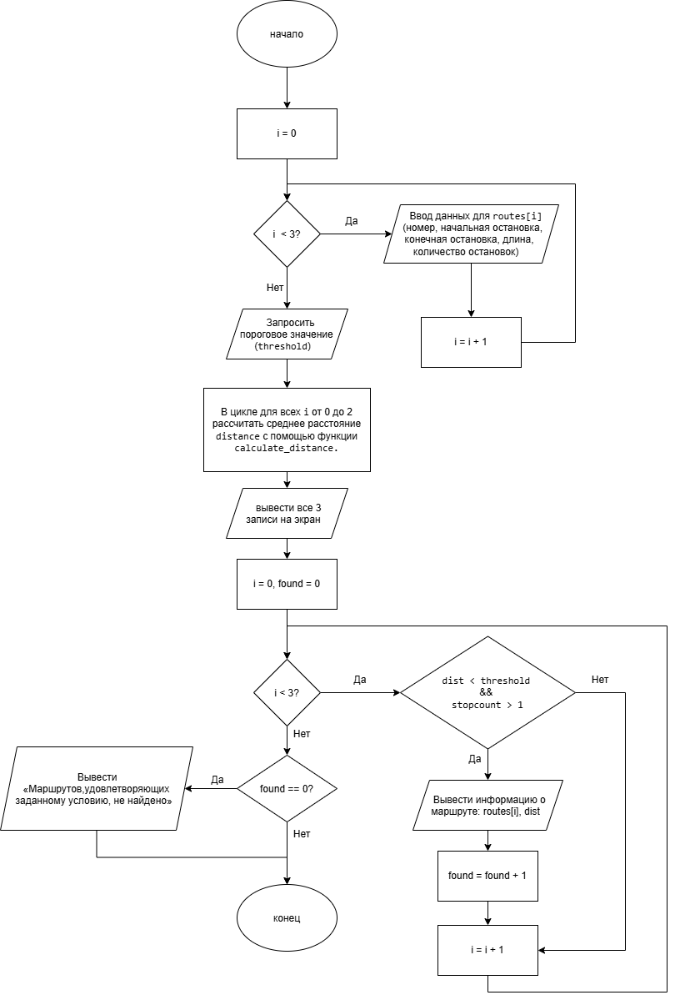

# Домашнее задание к работе 11

## Условие задачи

Создать структуру для хранения записи «Автобусный маршрут».

Поля записи:

номер маршрута
начальная остановка
конечная остановка
длина маршрута в километрах
количество остановок

Вычислить среднее расстояние между остановками для каждого маршрута и вывести сведения о маршрутах, где оно меньше заданного значения.

---

## 1. Алгоритм и блок-схема

### Алгоритм

1. Задать константу: количество записей `COUNT = 3`.
2. Описать структуру `Busroute` с полями для хранения номера маршрута (`number`), начальной остановки (`startroad`), конечной остановки (`stoproad`), длины маршрута (`length`) и количества остановок (`stopcount`).
3. Настроить локализацию для корректного отображения русскоязычных сообщений в консоли.
4. В цикле от 0 до 2 запросить у пользователя и считать данные для 3 записей маршрутов: номер, начальную и конечную остановку, длину маршрута в километрах и количество остановок.
5. Запросить у пользователя пороговое значение среднего расстояния (`treshholdvalue`).
6. Вызвать функцию обработки `process_routes`:
   - В цикле по всем записям рассчитать среднее расстояние между остановками с помощью функции `calculate_distance` (с защитой от деления на ноль, если остановок 1 или меньше, где количество перегонов равно `stopcount - 1`).
   - Вывести на экран информацию по каждой из 3 записей маршрутов вместе с рассчитанным средним расстоянием.
   - В отдельном цикле проверить условие отбора: `dist < threshold` (при этом количество остановок должно быть больше 1). При выполнении условия вывести запись на экран и увеличить счетчик найденных записей `found`.
   - Если ни одна запись не подошла под условие (`found == 0`), вывести соответствующее сообщение.
7. Завершить выполнение программы.

## Блок-схема

---

## 2. Реализация программы
---

## 3. Результаты работы программы

---

## 4. Информация о разработчике

- **ФИО:** Губский Данил Максимович
- **Группа:** бОТИ-261
